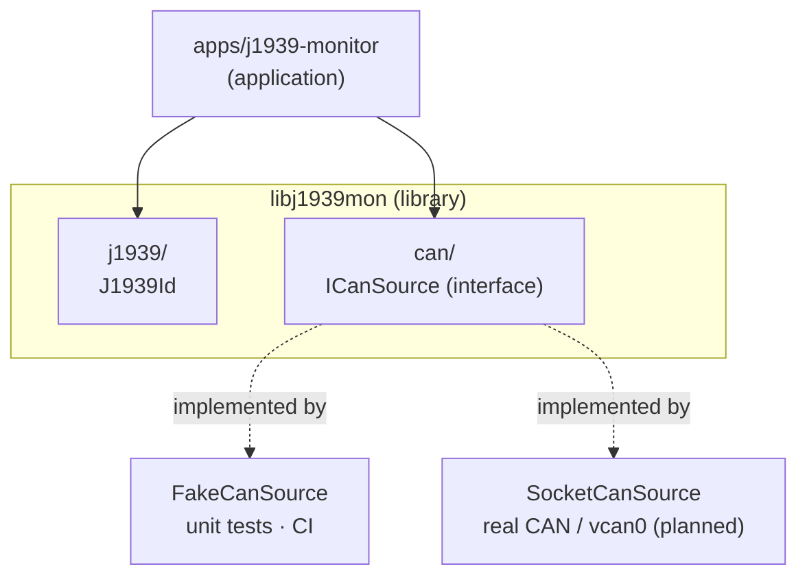

# j1939-monitor

[](https://github.com/Amir7698/j1939-monitor/actions/workflows/ci.yml)


A **J1939 monitor for embedded Linux**, written in **C++11**.

It reads CAN traffic from heavy-duty vehicles (trucks, tractors, agricultural machines) and turns raw frames into readable information:

```text
0CF00400  FF FF FF 40 1F FF FF FF
    ↓
[Engine, SA 0x00]  EEC1 (PGN 61444)  →  priority 3, broadcast
```

The goal is a small but **industrial-style** codebase: a reusable library, a hardware-independent design, unit tests, a containerized build and a CI pipeline on every push.

> 🚧 **Work in progress.** See the [roadmap](#roadmap) for what is done and what comes next.

---

## Features

- **J1939 identifier decoding**: priority, PDU format, source address from the 29-bit CAN ID.
- **Hardware-independent CAN input** through the `ICanSource` interface. The same decoding code runs on a fake source (unit tests, CI) and, later, on a real SocketCAN bus.
- **Unit-tested** with GoogleTest.
- **Reproducible build** in a Docker container, so the toolchain is identical on every machine.
- **Continuous integration** with GitHub Actions: build and tests run on every push.

---

## Architecture



**Key design choice:** the decoding logic only depends on the `ICanSource` interface, never on a concrete CAN driver. That's what makes the code testable without a vehicle, and lets the same binary logic run on a laptop, in CI, and on the target device.

| Component | Role |
|---|---|
| `CanFrame` | One classic CAN frame: 29-bit ID, length, up to 8 data bytes. |
| `ICanSource` | Interface: anything that can `read()` a `CanFrame`. |
| `FakeCanSource` | Returns predefined frames, for tests and development. |
| `J1939Id` | Immutable value class that decodes the fields of a J1939 identifier. |

---

## J1939 in 30 seconds

J1939 is an SAE protocol on top of CAN, used in trucks, buses and agricultural machines (ISOBUS / ISO 11783 is based on it). Every message has a **29-bit identifier**:

```text
 28  26 25  24 23        16 15         8 7          0
┌──────┬───┬───┬────────────┬────────────┬────────────┐
│ Prio │ R │DP │ PDU Format │PDU Specific│ Source Addr│
└──────┴───┴───┴────────────┴────────────┴────────────┘
  3 bit             8 bit        8 bit        8 bit
```

- **Priority**: 0 is the most urgent; the lowest value wins arbitration.
- **PDU Format ≥ 240**: broadcast message. **< 240**: the message has a destination address.
- **Source address**: who sent it (for example `0x00` = engine, `0x0B` = brakes).

Example: `0x0CF00400` → priority **3**, PDU format **0xF0** (broadcast), PGN **61444 (EEC1)**, source **0x00 (engine)**.

---

## Build and test

### Option 1: Docker (recommended, no local setup)

```bash
docker build -t j1939-build docker/
docker run --rm -v "$PWD":/src j1939-build bash -c \
  "cmake -S . -B build-docker -G Ninja && cmake --build build-docker && ./build-docker/unit_tests"
```

### Option 2: Native (Ubuntu 24.04)

```bash
sudo apt install -y g++ cmake ninja-build libgtest-dev
cmake -S . -B build -G Ninja
cmake --build build
./build/unit_tests        # run the unit tests
./build/j1939-monitor     # run the application
```

### Memory check

```bash
valgrind --leak-check=full ./build/j1939-monitor
```

---

## Project structure

```text
j1939-monitor/
├── apps/j1939-monitor/      application entry point
├── include/j1939mon/        public headers (the library API)
│   ├── can/                 CanFrame, ICanSource, FakeCanSource
│   └── j1939/               J1939Id
├── src/                     library implementation
├── tests/unit/              GoogleTest unit tests
├── docker/Dockerfile        pinned build environment
├── .github/workflows/ci.yml CI pipeline
└── CMakeLists.txt           target-based CMake build
```

---

## Engineering choices

- **C++11 only**, as commonly required on embedded Linux targets. The unit-test executable uses C++14 only because GoogleTest ≥ 1.13 requires it; the library itself stays C++11.
- **Fixed-width types** (`uint8_t`, `uint32_t`) for all bus data: exact sizes, no sign issues in bit operations.
- **Immutable value types**: `J1939Id` is set once in the constructor; all getters are `const`.
- **RAII and `std::unique_ptr`** instead of manual `new` / `delete`; no dynamic allocation planned in the main loop.
- **Interfaces only where there are real alternatives** (fake vs. real CAN), not everywhere.
- **Warnings on**: `-Wall -Wextra -Wpedantic`.

---

## Roadmap

- [x] J1939 identifier decoding (`J1939Id`)
- [x] Library / application / tests split with CMake
- [x] Unit tests with GoogleTest
- [x] Dockerized build environment
- [x] GitHub Actions CI
- [x] `CanFrame`, `ICanSource` interface, `FakeCanSource`
- [ ] PGN / SPN decoding: engine speed, coolant temperature, vehicle speed
- [ ] `SocketCanSource` on Linux SocketCAN (`vcan0`), event loop with `epoll`
- [ ] Python ECU simulator (`python-can`) and system tests with `pytest`
- [ ] J1939 transport protocol (BAM) and DM1 diagnostic messages
- [ ] ISO-TP (ISO 15765-2) and a minimal UDS (ISO 14229) client
- [ ] Daemon mode with systemd and clean SIGTERM shutdown
- [ ] ARM64 cross-compilation and release artifacts with checksums
- [ ] Static analysis (clang-tidy, cppcheck), sanitizers and coverage in CI

---

## Author

**Amirhossein Mohtashami**, M.Sc. Electronic Engineering, Politecnico di Torino.
Embedded firmware engineer interested in embedded Linux, CAN-based systems and test automation.
