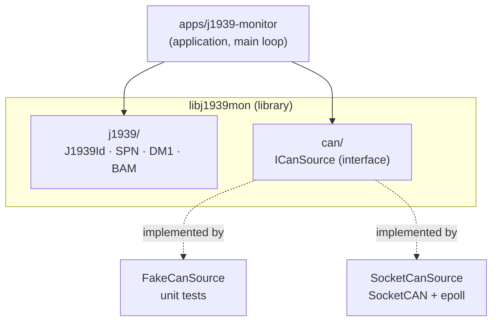

# j1939-monitor

[](https://github.com/Amir7698/j1939-monitor/actions/workflows/ci.yml)


A **J1939 monitor for embedded Linux**, written in **C++11**.

It listens to a CAN bus through Linux SocketCAN, decodes the J1939 identifier (priority, PGN, source and destination), turns raw data bytes into physical values (engine speed, coolant temperature), reassembles multi-packet messages sent with the J1939 transport protocol (BAM), and shows active diagnostic trouble codes (DM1) from the engine ECU.

A Python ECU simulator drives the whole chain on a virtual CAN bus. When the simulated engine overheats it reports **two faults at once**, which do not fit in one 8-byte CAN frame, so they travel as a BAM transfer and are reassembled by the monitor:

```text
$ ./build/j1939-monitor            # terminal 1
$ python3 tools/ecu_sim.py         # terminal 2

rpm: 1000
coolant: 89 °C
DM1: no active faults
...
coolant: 90 °C
DM1: SPN 110 FMI 0 OC 1 [amber]    # coolant temperature: above normal
DM1: SPN 100 FMI 1 OC 2 [amber]    # oil pressure: below normal
```

If a sender starts a BAM transfer and then goes silent, the half-built message is dropped after the J1939 T1 timeout, even though no further frame ever arrives:

```text
$ cansend vcan0 1CECFF00#200A0002FFCAFE00    # TP.CM only, no data packets follow
BAM timeout from SA 0
```

The goal is a small but **industrial-style** codebase: a reusable library, a hardware-independent design, unit tests for every decoder and every failure path, a containerized build, and CI on every push.

### Library usage

```cpp
#include "j1939mon/j1939/j1939_id.hpp"
#include "j1939mon/j1939/spn.hpp"
#include "j1939mon/j1939/dm1.hpp"
#include "j1939mon/j1939/bam.hpp"

CanFrame frame = {0x0CF00400, 8, {0xFF, 0xFF, 0xFF, 0x40, 0x1F, 0xFF, 0xFF, 0xFF}};

J1939Id id(frame.id);
id.pgn();                 // 0xF004 (61444, EEC1)
id.sourceAddress();       // 0x00   (engine)
id.destinationAddress();  // 0xFF   (PDU2: broadcast)

SpnValue rpm = decodeEngineSpeed(frame);
rpm.available;            // true
rpm.value;                // 1000.0 rpm  (0x1F40 × 0.125)

// Single-frame DM1: amber lamp, SPN 110 (coolant temperature), FMI 0, OC 1
CanFrame dm1 = {0x18FECA00, 8, {0x04, 0xFF, 0x6E, 0x00, 0x00, 0x01, 0xFF, 0xFF}};
Dm1 faults = decodeDm1(dm1);
faults.amberWarningLamp;  // true
faults.dtc.spn;           // 110

// Multi-packet message: feed every frame with a timestamp in ms
BamReassembler bam(0x00);              // follows sender 0x00 only
if (bam.onFrame(frame, nowMs))         // true when the transfer is complete
    use(bam.pgn(), bam.data(), bam.size());
bam.checkTimeout(nowMs);               // call regularly, even when the bus is silent
```

Every value above is checked by a unit test.

---

## Features

### J1939 decoding
- **Identifier**: priority, PDU format, source address from the 29-bit CAN ID.
- **PGN** following the PDU1 / PDU2 rule (the PDU Specific byte is a destination address when PF < 240), including the data page bit, plus the destination address (`0xFF` for broadcasts).
- **SPN values**: engine speed (SPN 190, two little-endian bytes, 0.125 rpm/bit) and coolant temperature (SPN 110, one byte, 1 °C/bit, offset −40 °C). Only the valid range is accepted (up to `0xFAFF` for two bytes, up to `0xFA` for one byte); reserved, error and "not available" codes are all reported as not available, never converted into a fake number.

### Diagnostics (DM1, PGN 65226 / `0xFECA`)
- **Lamp status**: malfunction indicator (MIL), red stop and amber warning lamps, 2 bits each.
- **Trouble codes (DTC)**: 19-bit SPN split over three bytes, 5-bit FMI and 7-bit occurrence count.
- **"No active faults"** (SPN 0, FMI 0) is recognized and shown as such.
- The same decoder works on a single 8-byte frame and on a longer payload rebuilt by BAM, so a DM1 with any number of DTCs is printed in full.

### Transport protocol (BAM, J1939-21)
- **Reassembly** of broadcast multi-packet messages: one TP.CM announcement (PGN `0xEC00`, control byte 32) followed by numbered TP.DT packets (PGN `0xEB00`, 7 payload bytes each); the `0xFF` padding of the last packet is not copied.
- **Failure paths, each with a unit test**: missing packet, repeated packet, T1 timeout (750 ms between packets, with and without further traffic), announced size outside 9–1785 bytes, packet count that does not match the size, frame shorter than 8 bytes, packet from another sender, and a new announcement in the middle of a transfer (the old one is dropped, the new one completes normally).
- **One session per sender**: each `BamReassembler` follows a single source address and ignores packets from other ECUs, so two ECUs sending BAM at the same time cannot corrupt each other. The monitor keeps one reassembler per source address it has heard.
- **Fixed-size buffer** (1785 bytes, the BAM maximum): receiving a transfer never allocates memory.
- **Testable timeouts**: the current time is passed in as a parameter instead of being read inside the class, so tests can move the clock without sleeping.

### Linux integration
- **SocketCAN input**: `SocketCanSource` opens a raw CAN socket and binds it to an interface. File descriptors are owned with RAII: opened in the constructor, closed in the destructor.
- **`epoll` with a 100 ms timeout**: the read loop wakes up at least every 100 ms even when the bus is silent, which is what lets BAM timeouts fire without incoming traffic.
- **Monotonic clock**: timeouts use `std::chrono::steady_clock`, which never jumps when the wall-clock time changes.
- **Error handling without leaks**: a missing interface or a failed `socket()`, `bind()`, `epoll_create1()` or `epoll_ctl()` throws from the constructor, which first closes anything it already opened (a throwing constructor never runs the destructor); `main` prints the error to stderr and exits with code 1.
- **Clean shutdown**: SIGINT and SIGTERM set a flag through `sigaction`; `epoll_wait` returns, the loop ends, the destructor closes the descriptors and the process exits with code 0.

### Tooling
- **Hardware-independent CAN input** through the `ICanSource` interface: the same decoding code runs on a fake source and on the real bus. Adding `epoll` changed only `SocketCanSource`; the interface and the decoders stayed the same.
- **ECU simulator** in Python (`python-can`): engine speed every 100 ms (800 → 2000 rpm ramp), coolant temperature every second (warming from 80 to 90 °C), and DM1 every second: "no active faults" as a single frame, then two DTCs over BAM once the engine reaches 90 °C.
- **Tests**: 34 GoogleTest unit tests for the C++ library and 5 pytest unit tests for the simulator's frame builders.
- **Reproducible build** in a Docker container, so the toolchain is identical on every machine.
- **CI with GitHub Actions**: three jobs on every push: C++ build and tests in Docker, the same tests under AddressSanitizer + UndefinedBehaviorSanitizer, and Python tests.
- **Local Jenkins pipeline** (`Jenkinsfile`, Build and Test stages with JUnit test reports), runnable in Docker with `scripts/jenkins.sh`.

---

## Architecture



**Key design choice:** the decoding logic only depends on the `ICanSource` interface, never on a concrete CAN driver. That's what makes the code testable without a vehicle, and lets the same logic run on a laptop, in CI, and on the target device.

What happens to one frame in the main loop:

1. `SocketCanSource::read()` waits up to 100 ms in `epoll_wait()`. If a frame arrives, it is read and converted to a `CanFrame`.
2. `J1939Id` extracts the PGN and the source address.
3. Engine speed, coolant temperature and single-frame DM1 are decoded and printed directly.
4. TP.CM / TP.DT frames go to the `BamReassembler` of their source address; when a transfer completes and it carries a DM1, every DTC is printed.
5. Whether a frame arrived or not, every reassembler is asked to `checkTimeout()`.

| Component | Role |
|---|---|
| `CanFrame` | One classic CAN frame: 29-bit ID, length, up to 8 data bytes. |
| `ICanSource` | Interface: anything that can `read()` a `CanFrame`. Returns `false` when nothing arrived. |
| `FakeCanSource` | Returns a predefined frame, for tests and development. |
| `SocketCanSource` | Reads real frames from a Linux SocketCAN interface, waiting with `epoll`. |
| `J1939Id` | Immutable value class that decodes the fields of a J1939 identifier, the PGN and the destination. |
| `SpnValue`, `decodeEngineSpeed()`, `decodeCoolantTemp()` | Decode a physical value from the data bytes and say whether it is available. |
| `Dtc`, `Dm1`, `decodeDtc()`, `decodeDm1()` | Decode lamp status and trouble codes, from a single frame or from a reassembled payload. |
| `BamReassembler` | Rebuilds one BAM transfer from one sender, with sequence, size, length and timeout checks. |

---

## J1939 in 30 seconds

J1939 is an SAE protocol on top of CAN, used in trucks, buses and agricultural machines (ISOBUS / ISO 11783 is based on it). Every message has a **29-bit identifier**:

```text
 28  26 25  24 23        16 15         8 7          0
┌──────┬───┬───┬────────────┬────────────┬────────────┐
│ Prio │ R │DP │ PDU Format │PDU Specific│ Source Addr│
└──────┴───┴───┴────────────┴────────────┴────────────┘
  3 bit             8 bit        8 bit        8 bit
```

- **Priority**: 0 is the most urgent; the lowest value wins arbitration.
- **PDU Format ≥ 240**: broadcast message. **< 240**: the message has a destination address.
- **Source address**: who sent it (for example `0x00` = engine, `0x0B` = brakes).

Example: `0x0CF00400` → priority **3**, PDU format **0xF0** (broadcast), PGN **61444 (EEC1)**, source **0x00 (engine)**.

**Messages longer than 8 bytes** use the transport protocol. With BAM (broadcast), the sender first announces the size, the number of packets and the PGN in a TP.CM frame, then sends the data in numbered TP.DT frames of 7 bytes each, 50–200 ms apart. The receiver puts them back together and gives up if a packet is missing or more than 750 ms (T1) pass between packets.

```text
TP.CM  1CECFF00  20 0A 00 02 FF CA FE 00   BAM, 10 bytes, 2 packets, PGN 0xFECA (DM1)
TP.DT  1CEBFF00  01 04 FF 6E 00 00 01 64   packet 1: 7 bytes
TP.DT  1CEBFF00  02 00 01 02 FF FF FF FF   packet 2: 3 bytes + padding
```

---

## Build and test

### Option 1: Docker (recommended, no local setup)

```bash
docker build -t j1939-build docker/
docker run --rm -v "$PWD":/src j1939-build bash -c \
  "cmake -S . -B build-docker -G Ninja && cmake --build build-docker && ./build-docker/unit_tests"
```

### Option 2: Native (Ubuntu 24.04)

```bash
sudo apt install -y g++ cmake ninja-build libgtest-dev
cmake -S . -B build -G Ninja
cmake --build build
./build/unit_tests        # run the C++ unit tests
./build/j1939-monitor     # run the application (listens on vcan0)
```

### Python tests

```bash
sudo apt install -y python3-pytest python3-can
python3 -m pytest -v      # settings in pytest.ini
```

### Run on a virtual CAN bus

Create `vcan0` (needs the `vcan` kernel module), start the monitor, then start the ECU simulator in a second terminal:

```bash
./scripts/setup_vcan.sh                        # creates and brings up vcan0

./build/j1939-monitor                          # terminal 1, stop with Ctrl+C
python3 tools/ecu_sim.py                       # terminal 2
```

After about 10 seconds the simulated coolant reaches 90 °C and the two-DTC DM1 appears. Single frames can also be sent by hand with `cansend` (package `can-utils`):

```bash
cansend vcan0 0CF00400#FFFFFF401FFFFFFF        # EEC1, 1000 rpm
cansend vcan0 18FECA00#04FF6E000001FFFF        # DM1, one DTC
cansend vcan0 1CECFF00#200A0002FFCAFE00        # TP.CM alone: "BAM timeout" after ~750 ms
```

### Local Jenkins

```bash
./scripts/jenkins.sh      # Jenkins on http://localhost:8080 with a job that runs the Jenkinsfile
```

### Memory and undefined-behavior checks

The unit tests also run under AddressSanitizer and UndefinedBehaviorSanitizer (in a separate build directory, because sanitized code is slower):

```bash
cmake -S . -B build-asan -G Ninja -DJ1939MON_SANITIZE=ON
cmake --build build-asan
./build-asan/unit_tests
```

The setup was checked by injecting two bugs on purpose: a missing `return` in a `bool` function (reported by UBSan) and a 4-byte read from a 2-byte array (reported by ASan as a stack-buffer-overflow, with file and line).

The application itself can be checked with Valgrind:

```bash
valgrind --leak-check=full ./build/j1939-monitor
```

---

## Project structure

```text
j1939-monitor/
├── apps/j1939-monitor/      application entry point and main loop
├── include/j1939mon/        public headers (the library API)
│   ├── can/                 CanFrame, ICanSource, FakeCanSource, SocketCanSource
│   └── j1939/               J1939Id, SPN, DM1, BAM
├── src/                     library implementation (can/, j1939/)
├── tests/unit/              GoogleTest unit tests (C++)
├── tests/python/            pytest unit tests (simulator)
├── tools/ecu_sim.py         Python fake engine ECU (python-can)
├── scripts/setup_vcan.sh    creates the vcan0 interface
├── scripts/jenkins.sh       starts a local Jenkins in Docker
├── docker/Dockerfile        pinned build environment
├── docker/jenkins/          Jenkins image and job definition
├── .github/workflows/ci.yml CI pipeline (C++, sanitizers, Python)
├── Jenkinsfile              Jenkins pipeline (Build, Test)
├── pytest.ini               pytest settings
└── CMakeLists.txt           target-based CMake build
```

---

## Engineering choices

- **C++11 as the minimum standard**, so the library also builds with older embedded toolchains. The unit-test executable uses C++14 only because GoogleTest ≥ 1.13 requires it.
- **Fixed-width types** (`uint8_t`, `uint32_t`) for all bus data: exact sizes, no sign issues in bit operations.
- **Immutable value types**: `J1939Id` is set once in the constructor; all getters are `const`.
- **No allocation while receiving**: frames, identifiers and decoded values are plain values, and `BamReassembler` uses a fixed 1785-byte buffer. The only heap allocation is in the application: one reassembler is created the first time a new source address sends a transport frame, and it is reused for every later transfer from that sender.
- **Time is an input**: `BamReassembler` never reads the clock itself; the caller passes the time in milliseconds. Timeouts are tested by moving that number, not by sleeping.
- **Strict BAM receiver**: any packet out of sequence drops the whole transfer instead of guessing; the next TP.CM starts a clean one.
- **Interfaces only where there are real alternatives** (fake vs. real CAN), not everywhere.
- **Warnings on**: `-Wall -Wextra -Wpedantic`, plus an optional sanitizer build (`-DJ1939MON_SANITIZE=ON`) that CI runs on every push.

## Known limitations

- Only the broadcast transport protocol (BAM) is implemented. Peer-to-peer transfers (RTS/CTS, connection mode) are not.
- Reserved, error and "not available" SPN values are all reported as not available; the decoder does not yet say which of the three it was.
- DM1: the lamp flash byte and the SPN conversion method bit are ignored (conversion method version 4 is assumed).
- The interface name `vcan0` is fixed in `main.cpp`; it is not a command-line option yet.
- The pytest tests check the simulator's frame builders; there is no end-to-end test that runs the monitor and the simulator together yet.

---

## Roadmap

- [x] J1939 identifier decoding (`J1939Id`)
- [x] Library / application / tests split with CMake
- [x] Unit tests with GoogleTest
- [x] Dockerized build environment
- [x] GitHub Actions CI
- [x] `CanFrame`, `ICanSource` interface, `FakeCanSource`
- [x] PGN calculation (PDU1 / PDU2, data page) and destination address
- [x] Engine speed SPN (190) and coolant temperature SPN (110), valid range only (reserved / error / not available rejected)
- [x] `SocketCanSource` on Linux SocketCAN (`vcan0`)
- [x] Error handling for `socket()` / `bind()` / missing interface, without leaking descriptors
- [x] Clean shutdown on Ctrl+C / SIGTERM
- [x] Python ECU simulator (`tools/ecu_sim.py`) and `scripts/setup_vcan.sh`
- [x] DM1 diagnostic messages: lamps and DTCs, single frame and multi-packet
- [x] J1939 transport protocol: BAM reassembly with sequence, size, length and per-sender checks
- [x] `epoll` loop with a 100 ms timeout, so BAM timeouts fire on a silent bus
- [x] pytest unit tests for the simulator, run in CI
- [x] Local Jenkins pipeline
- [x] AddressSanitizer and UndefinedBehaviorSanitizer builds in CI
- [ ] End-to-end test: run the monitor and the simulator together on `vcan0` and check the output
- [ ] Interface name as a command-line argument
- [ ] Vehicle speed SPN and separate reporting of the error indicator
- [ ] RTS/CTS (connection mode) transport protocol

---

## Author

**Amirhossein Mohtashami**, M.Sc. Electronic Engineering, Politecnico di Torino.
Embedded firmware engineer interested in embedded Linux, CAN-based systems and test automation.
