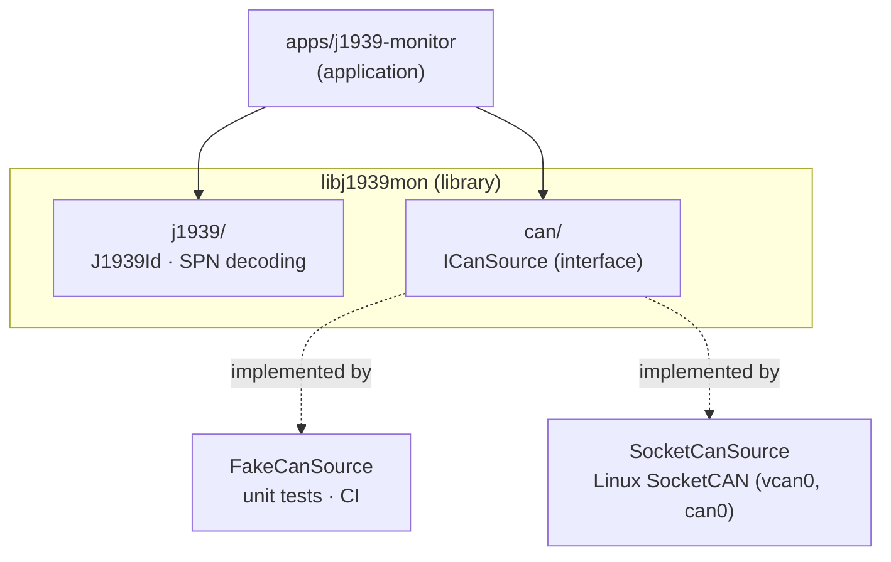

# j1939-monitor

[](https://github.com/Amir7698/j1939-monitor/actions/workflows/ci.yml)


A **J1939 monitor for embedded Linux**, written in **C++11**.

It reads CAN frames from heavy-duty vehicles (trucks, tractors, agricultural machines) through Linux SocketCAN, decodes the J1939 identifier (priority, PGN, source and destination) and turns raw data bytes into physical values such as engine speed and coolant temperature.

Running `./build/j1939-monitor` while frames are sent on `vcan0` with `cansend`:

```text
$ cansend vcan0 0CF00400#FFFFFF401FFFFFFF    # EEC1, engine speed 0x1F40
$ cansend vcan0 0CF00400#FFFFFFFFFFFFFFFF    # EEC1, engine speed not available
$ cansend vcan0 18FEEE00#82FFFFFFFFFFFFFF    # ET1, coolant 0x82
$ cansend vcan0 18FEEE00#FFFFFFFFFFFFFFFF    # ET1, coolant not available
```

```text
rpm: 1000
rpm: N/A
coolant: 90 °C
coolant: N/A
```

Other PGNs are ignored. A "not available" value is shown as `N/A`, never as a fake `0`.

The goal is a small but **industrial-style** codebase: a reusable library, a hardware-independent design, unit tests, a containerized build and a CI pipeline on every push.

> 🚧 **Work in progress.** Reading from SocketCAN works with a blocking `read()`, setup errors are reported, and Ctrl+C / SIGTERM stop the monitor cleanly. `epoll` and the J1939 transport protocol are next. See the [roadmap](#roadmap).

### Library usage

```cpp
#include "j1939mon/j1939/j1939_id.hpp"
#include "j1939mon/j1939/spn.hpp"

CanFrame frame = {0x0CF00400, 8, {0xFF, 0xFF, 0xFF, 0x40, 0x1F, 0xFF, 0xFF, 0xFF}};

J1939Id id(frame.id);
id.pgn();                 // 0xF004 (61444, EEC1)
id.sourceAddress();       // 0x00   (engine)
id.destinationAddress();  // 0xFF   (PDU2: broadcast)

SpnValue rpm = decodeEngineSpeed(frame);
rpm.available;            // true
rpm.value;                // 1000.0 rpm  (0x1F40 × 0.125)

CanFrame et1 = {0x18FEEE00, 8, {0x82, 0xFF, 0xFF, 0xFF, 0xFF, 0xFF, 0xFF, 0xFF}};
decodeCoolantTemp(et1).value;   // 90.0 °C  (130 − 40)
```

Every value above is checked by a unit test.

---

## Features

- **J1939 identifier decoding**: priority, PDU format, source address from the 29-bit CAN ID.
- **PGN calculation** following the PDU1 / PDU2 rule (the PDU Specific byte is a destination address when PF < 240), including the data page bit, plus the destination address (`0xFF` for broadcasts).
- **SPN decoding**: engine speed (SPN 190, two little-endian bytes, 0.125 rpm/bit) and coolant temperature (SPN 110, one byte, 1 °C/bit, offset −40 °C). "Not available" values (`0xFF00`–`0xFFFF` for two bytes, `0xFF` for one byte) are reported as such, never converted into a fake number.
- **Linux SocketCAN input**: `SocketCanSource` opens a raw CAN socket, binds it to an interface (`vcan0`, `can0`, ...) and reads frames. The file descriptor is owned with RAII: opened in the constructor, closed in the destructor.
- **Error handling without leaks**: a missing interface, a failed `socket()` or a failed `bind()` throws from the constructor, which first releases anything it already opened; `main` prints the error to stderr and exits with code 1.
- **Clean shutdown**: SIGINT and SIGTERM set a flag through `sigaction`, the read loop ends, the destructor closes the socket and the process exits with code 0.
- **ECU simulator** in Python (`python-can`): a fake engine that sends engine speed every 100 ms, ramping 800 → 2000 rpm, and coolant temperature every second, warming up to 90 °C.
- **Hardware-independent CAN input** through the `ICanSource` interface. The same decoding code runs on a fake source and on the real SocketCAN bus; switching from one to the other did not change the decoding code.
- **Unit-tested** with GoogleTest.
- **Reproducible build** in a Docker container, so the toolchain is identical on every machine.
- **Continuous integration** with GitHub Actions: build and tests run on every push.

---

## Architecture



**Key design choice:** the decoding logic only depends on the `ICanSource` interface, never on a concrete CAN driver. That's what makes the code testable without a vehicle, and lets the same binary logic run on a laptop, in CI, and on the target device.

| Component | Role |
|---|---|
| `CanFrame` | One classic CAN frame: 29-bit ID, length, up to 8 data bytes. |
| `ICanSource` | Interface: anything that can `read()` a `CanFrame`. |
| `FakeCanSource` | Returns predefined frames, for tests and development. |
| `SocketCanSource` | Reads real frames from a Linux SocketCAN interface and converts them to `CanFrame`. |
| `J1939Id` | Immutable value class that decodes the fields of a J1939 identifier, the PGN and the destination. |
| `SpnValue`, `decodeEngineSpeed()`, `decodeCoolantTemp()` | Decodes a physical value from the data bytes and says whether it is available. |

---

## J1939 in 30 seconds

J1939 is an SAE protocol on top of CAN, used in trucks, buses and agricultural machines (ISOBUS / ISO 11783 is based on it). Every message has a **29-bit identifier**:

```text
 28  26 25  24 23        16 15         8 7          0
┌──────┬───┬───┬────────────┬────────────┬────────────┐
│ Prio │ R │DP │ PDU Format │PDU Specific│ Source Addr│
└──────┴───┴───┴────────────┴────────────┴────────────┘
  3 bit             8 bit        8 bit        8 bit
```

- **Priority**: 0 is the most urgent; the lowest value wins arbitration.
- **PDU Format ≥ 240**: broadcast message. **< 240**: the message has a destination address.
- **Source address**: who sent it (for example `0x00` = engine, `0x0B` = brakes).

Example: `0x0CF00400` → priority **3**, PDU format **0xF0** (broadcast), PGN **61444 (EEC1)**, source **0x00 (engine)**.

---

## Build and test

### Option 1: Docker (recommended, no local setup)

```bash
docker build -t j1939-build docker/
docker run --rm -v "$PWD":/src j1939-build bash -c \
  "cmake -S . -B build-docker -G Ninja && cmake --build build-docker && ./build-docker/unit_tests"
```

### Option 2: Native (Ubuntu 24.04)

```bash
sudo apt install -y g++ cmake ninja-build libgtest-dev
cmake -S . -B build -G Ninja
cmake --build build
./build/unit_tests        # run the unit tests
./build/j1939-monitor     # run the application
```

### Run on a virtual CAN bus

Create `vcan0` (needs the `vcan` kernel module), start the monitor, then start the ECU simulator in a second terminal:

```bash
./scripts/setup_vcan.sh                        # creates and brings up vcan0
sudo apt install -y python3-can                # once, for the simulator

./build/j1939-monitor                          # terminal 1, stop with Ctrl+C
python3 tools/ecu_sim.py                       # terminal 2
```

Single frames can also be sent by hand with `cansend` (package `can-utils`):

```bash
cansend vcan0 0CF00400#FFFFFF401FFFFFFF
```

### Memory check

```bash
valgrind --leak-check=full ./build/j1939-monitor
```

---

## Project structure

```text
j1939-monitor/
├── apps/j1939-monitor/      application entry point
├── include/j1939mon/        public headers (the library API)
│   ├── can/                 CanFrame, ICanSource, FakeCanSource, SocketCanSource
│   └── j1939/               J1939Id, SPN decoding
├── src/                     library implementation (can/, j1939/)
├── tests/unit/              GoogleTest unit tests
├── tools/ecu_sim.py         Python fake engine ECU (python-can)
├── scripts/setup_vcan.sh    creates the vcan0 interface
├── docker/Dockerfile        pinned build environment
├── .github/workflows/ci.yml CI pipeline
└── CMakeLists.txt           target-based CMake build
```

---

## Engineering choices

- **C++11 as the minimum standard**, so the library also builds with older embedded toolchains. The unit-test executable uses C++14 only because GoogleTest ≥ 1.13 requires it.
- **Fixed-width types** (`uint8_t`, `uint32_t`) for all bus data: exact sizes, no sign issues in bit operations.
- **Immutable value types**: `J1939Id` is set once in the constructor; all getters are `const`.
- **No dynamic allocation in the decoding path**: frames and identifiers are plain values. Heap ownership, where needed (for example the CAN source chosen at runtime), will use `std::unique_ptr`.
- **Interfaces only where there are real alternatives** (fake vs. real CAN), not everywhere.
- **Warnings on**: `-Wall -Wextra -Wpedantic`.

---

## Roadmap

- [x] J1939 identifier decoding (`J1939Id`)
- [x] Library / application / tests split with CMake
- [x] Unit tests with GoogleTest
- [x] Dockerized build environment
- [x] GitHub Actions CI
- [x] `CanFrame`, `ICanSource` interface, `FakeCanSource`
- [x] PGN calculation (PDU1 / PDU2, data page) and destination address
- [x] Engine speed SPN (190) with the full "not available" range (`0xFF00`–`0xFFFF`)
- [x] Coolant temperature SPN (110) with resolution, offset and "not available"
- [ ] Vehicle speed SPN and the J1939 "error indicator" ranges
- [x] `SocketCanSource` on Linux SocketCAN (`vcan0`), blocking read loop printing engine speed and coolant temperature
- [x] Error handling for `socket()` / `bind()` / missing interface, without leaking the socket
- [x] Clean shutdown on Ctrl+C / SIGTERM
- [x] Python ECU simulator (`tools/ecu_sim.py`) and `scripts/setup_vcan.sh`
- [ ] `epoll` event loop, and pytest end-to-end tests driving the simulator
- [ ] J1939 transport protocol (BAM reassembly with timeouts) and DM1 diagnostic messages

---

## Author

**Amirhossein Mohtashami**, M.Sc. Electronic Engineering, Politecnico di Torino.
Embedded firmware engineer interested in embedded Linux, CAN-based systems and test automation.
